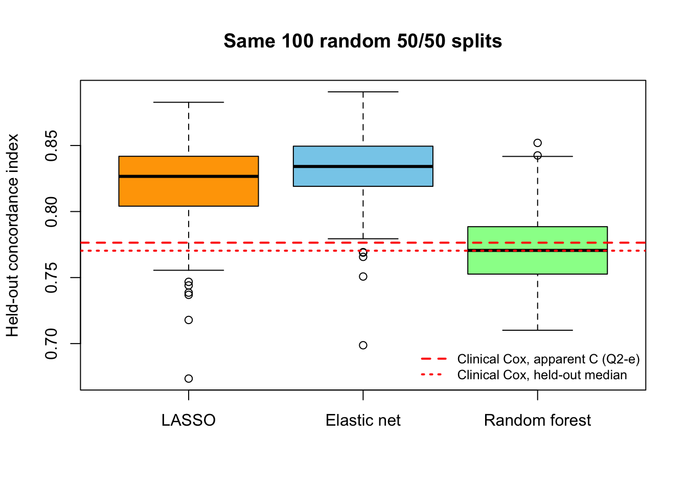
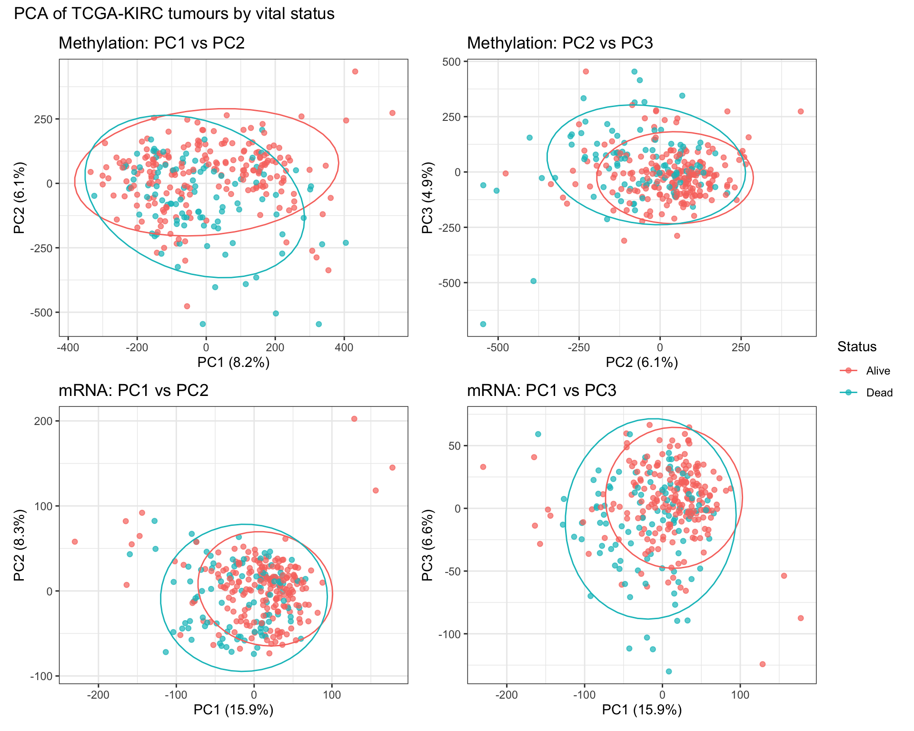
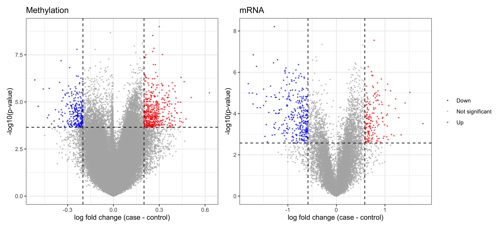
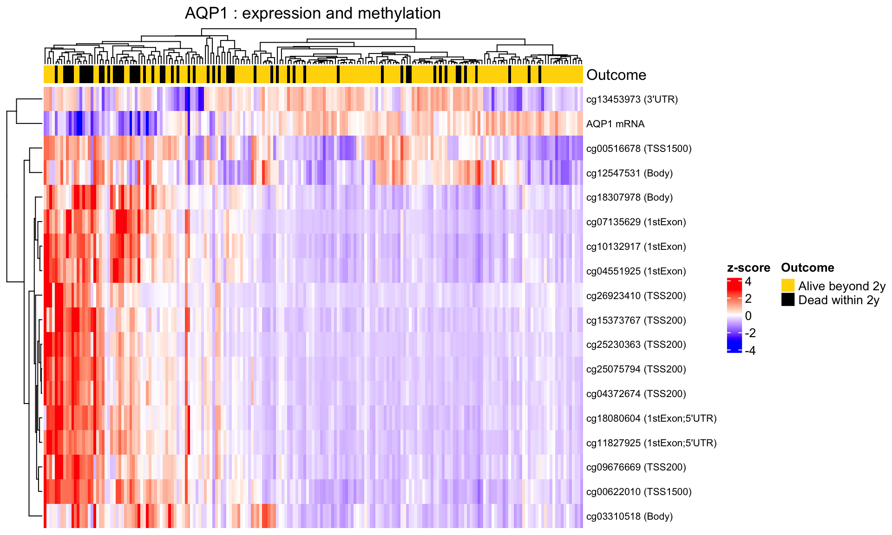
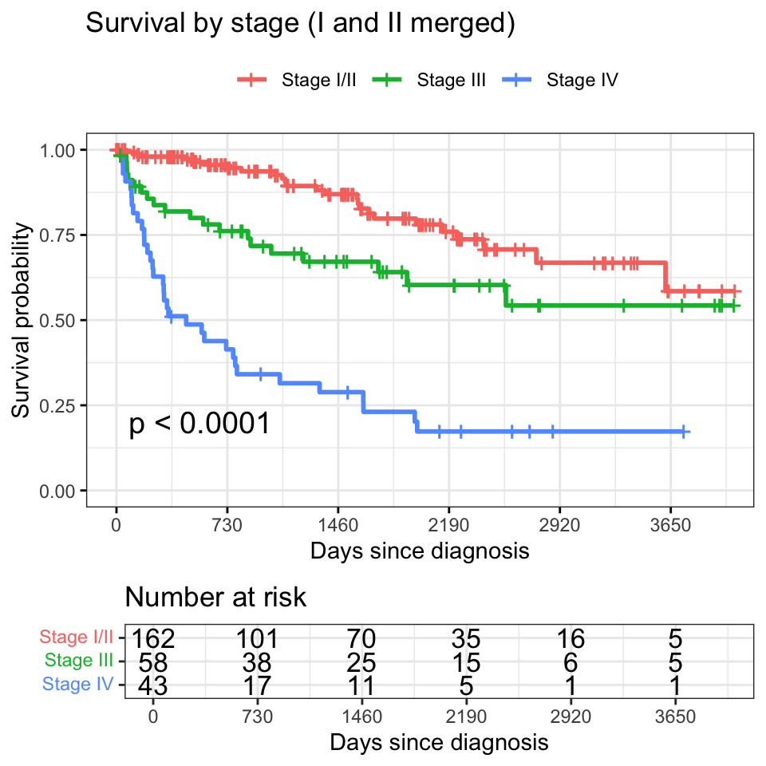
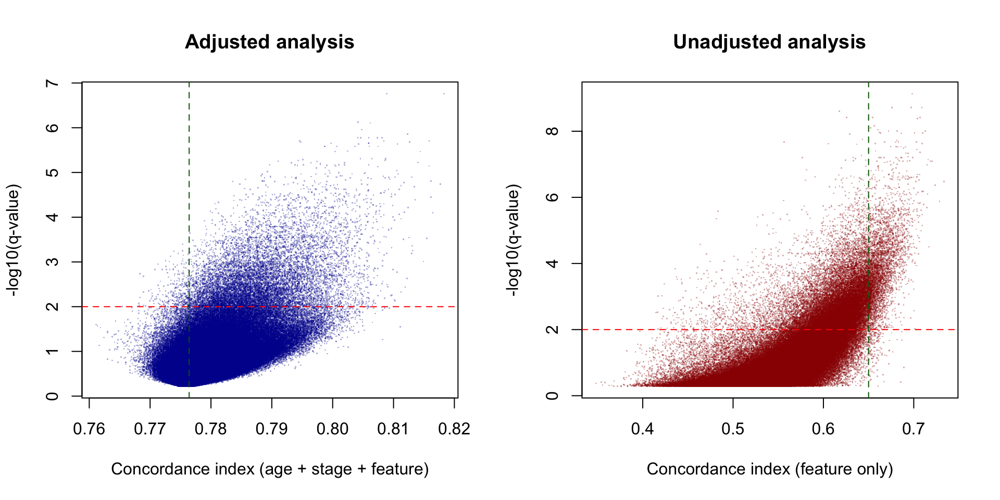
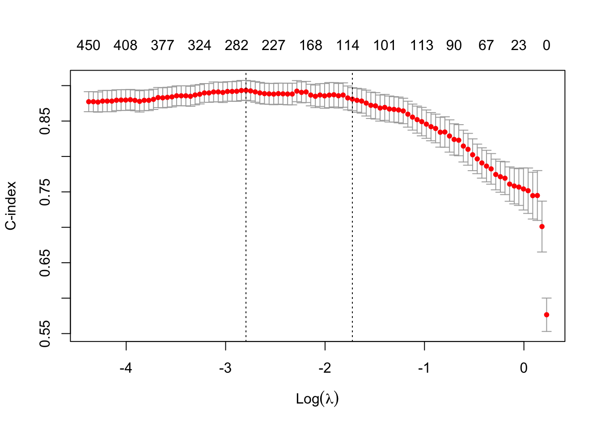

# Multi-omics survival modelling in kidney cancer (TCGA-KIRC)

Can DNA methylation and gene expression predict survival in clear cell renal cell carcinoma **beyond what tumour stage and age already tell us?**

This project analyses 309 tumours from The Cancer Genome Atlas (TCGA-KIRC), each profiled on ~330,000 CpG methylation probes and ~16,000 genes, together with clinical follow-up of up to 12 years. It moves from exploratory analysis and genome-wide screening to multivariable prognostic models that are evaluated on held-out patients against a clinical benchmark.

**Tools:** R · survival · glmnet · randomForestSRC · qvalue · ggplot2 · survminer · ComplexHeatmap

---

## Key findings

| | |
|---|---|
| **Clinical benchmark** | A Cox model with age and stage reaches a held-out C-index of **0.770**. Stage IV carries a hazard ratio of **7.8** relative to stage I/II; gender has no effect (HR 0.99). |
| **Genome-wide screen** | Of 346,329 features, **12,276** are associated with survival at 1% FDR *after* adjusting for age and stage (31,545 without adjustment). Much of the molecular signal therefore restates tumour stage, but a substantial part adds to it. |
| **Best model** | An **elastic-net Cox model** (stage + age + 1,650 screened features) reaches a mean held-out **C-index of 0.832** over 100 random train/test splits. It beats the clinical model in 95 of 100 splits and LASSO in 71 of 100. |
| **Linear vs non-linear** | A random survival forest does no better than the clinical model (C = 0.772). The signal looks like many weak, largely additive and highly correlated effects, which a penalised linear model captures better. |
| **Biology** | In the early-death analysis, promoter methylation of **AQP1** is high exactly where its expression is low. This is the pattern expected if methylation silences the gene, and these tumours are enriched for patients who died within two years. |

> **Caveat (stated honestly):** the 1,650 features were screened on all patients before the train/test splits, so the held-out C-indices of the molecular models are upper bounds. A fully nested evaluation (screening inside each training half) or an external cohort would be needed to confirm the gain over the clinical model.



---

## Analysis pipeline

### Part A: Which molecular features distinguish early deaths from long-term survivors?

1. **Data integration and QC.** The pipeline aligns 346,329 features with their annotation and the patient table, cleans the gene annotation, defines the survival outcome and removes patients with invalid follow-up.
2. **Unsupervised view (PCA).** The leading components of either platform (methylation PC1-4 explain 23% of the variance, mRNA 36%) do not separate deceased from surviving patients. Variance-driven analysis misses the outcome signal, so a supervised approach is needed.
3. **Case-control screen.** This step compares 56 patients who died within 2 years with 139 patients who were followed beyond 2 years and were still alive. It runs Welch t-tests on every probe and gene and controls the FDR with Storey's q-value. Per-platform correction finds **3,988 CpG probes and 1,960 genes** at 1% FDR. Pooling the two platforms would wrongly cut the mRNA discoveries by two thirds, because the two platforms have different null proportions (π₀ = 0.55 for methylation vs 0.45 for mRNA).
4. **Cross-platform integration.** 24 genes are significant on both platforms. AQP1 is examined in detail: an exact-symbol match finds its 17 CpG probes, whereas a naive `grep` would pick up 35 probes (it also matches AQP10, AQP11 and AQP12B). A clustered heatmap then shows how its promoter methylation relates to its expression.

### Part B: Building and honestly evaluating prognostic models

5. **Clinical survival analysis.** This step draws Kaplan–Meier curves and runs log-rank and Peto–Peto tests. Stages I and II are merged because their curves cross and are indistinguishable (p = 0.35). It then fits a clinical Cox model (C = 0.776 apparent).
6. **Genome-wide Cox screen.** It fits 2 × 346,329 Cox models (adjusted and unadjusted) and compares significance with discrimination. It also explains why q-value and C-index are related but not interchangeable.
7. **Penalised Cox regression.** An elastic net (α = 0.2) and a LASSO are fitted with λ tuned by cross-validated C-index. Each is evaluated on **100 random 50/50 splits, re-tuning λ inside every training half** to avoid information leakage.
8. **Random survival forest.** This step reports the out-of-bag Brier score (integrated 0.152) and variable importance with 95% CIs from 100 subsamples. It evaluates the forest on the same 100 splits.
9. **Comparison and interpretation.** It compares the models split by split with paired tests, checks how far the elastic net and the forest agree on features (they disagree because selected features form correlated groups), and examines methylation–expression pairs (for SLC22A2, r = −0.74).

---

## Selected figures

| | |
|---|---|
|  |  |
| *PCA does not separate outcome groups* | *Early death vs long-term survival, per platform* |
|  |  |
| *AQP1: promoter methylation vs expression* | *Survival by stage (I/II merged)* |
|  |  |
| *Significance is not discrimination* | *Elastic-net CV curve: broad plateau* |

All 17 figures are in [`figures/`](figures). The main result tables are in [`results/`](results).

---

## Repository structure

```
├── run_all.R                       # runs the full pipeline in order
├── R/
│   ├── 00_setup.R                  # paths, data loading and cleaning, helpers
│   ├── 01_pca.R                    # Part A: unsupervised view
│   ├── 02_early_death_screen.R     # Part A: t-test screen, q-values, volcano plots
│   ├── 03_aqp1_integration.R       # Part A: cross-platform genes, AQP1 heatmap
│   ├── 04_clinical_survival.R      # Part B: Kaplan-Meier, log-rank, clinical Cox
│   ├── 05_cox_screen.R             # Part B: 2 x 346k Cox models, feature screen
│   ├── 06_penalised_cox.R          # Part B: elastic net / LASSO, 100-split evaluation
│   ├── 07_random_survival_forest.R # Part B: RSF, Brier score, importance CIs
│   └── 08_compare_models.R         # Part B: head-to-head comparison
├── figures/                        # figures used in this README
├── results/                        # small result tables (CSV)
└── data/README.md                  # expected input files (data not included)
```

## How to run

1. Place the three input tables in `data/` (see [`data/README.md`](data/README.md)).
2. Install the packages:
   ```r
   install.packages(c("data.table", "survival", "survminer", "ggplot2", "patchwork",
                      "glmnet", "randomForestSRC", "circlize"))
   BiocManager::install(c("qvalue", "ComplexHeatmap"))
   ```
3. From the repository root, run `Rscript run_all.R`.

The slow steps are cached in `output/`, so later runs only redraw figures and tables. These steps are the two genome-wide screens (~15 min), the 100-split evaluations and the forest subsampling (~8 GB RAM). The random seeds are fixed (5241 and 2026), so the numbers above are reproducible.

## Data

The data come from TCGA-KIRC (kidney renal clear cell carcinoma). They combine Illumina 450K DNA methylation (β-values), RNA-seq gene expression and clinical annotation, all from the [NCI Genomic Data Commons](https://portal.gdc.cancer.gov/projects/TCGA-KIRC). Processed matrices are not redistributed here. The file formats are described in `data/README.md`.

## Background

This project grew out of coursework for the module MDG5241 at the National University of Singapore (MSc Biomedical Informatics, 2026). Here it is reorganised into one end-to-end, reproducible pipeline.

**Author:** Fangyu (Tommy) Hong · MSc Biomedical Informatics, NUS · [LinkedIn](https://www.linkedin.com/in/fangyu-hong-62ab5844b/)
